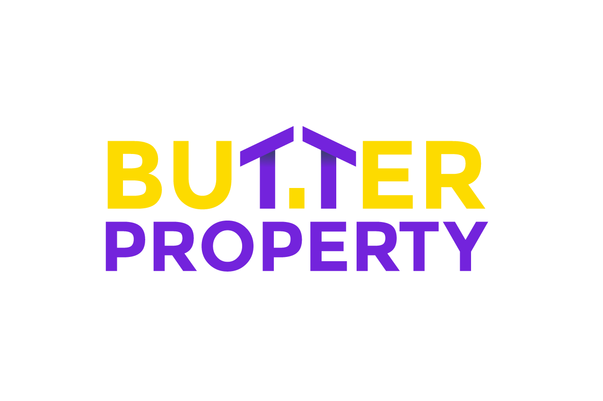

# Butter Property (butterproperty.com)

A bespoke, responsive, and minimalist boutique luxury real estate web application curated for high-net-worth investors across **India** and **Dubai**.



## Overview
Butter Property offers off-market and vetted prime properties across premier micro-markets in Mumbai, Bengaluru, Delhi-NCR, Downtown Dubai, Palm Jumeirah, and Dubai Marina. The platform blends Royal Purple (`#7323DC`) and signature Butter Yellow (`#FDDB00`) for an understated ultra-luxury visual experience.

## Key Features
- **Multi-Page Architecture**:
  - `index.html`: Main investor portal, dynamic filter bar, curated property showcase, off-market mandate banner, and value pillars.
  - `dubai-portfolio.html`: Dedicated Dubai portfolio focusing on 100% Freehold ownership, 10-Year Golden Visa residency, and 0% personal tax allocations.
  - `india-portfolio.html`: Dedicated India luxury portfolio focusing on RERA-verified titles, FEMA/LRS capital structuring, and premier micro-markets.
  - `property.html`: Single property dossier with 2.2x interactive zoom lens inspection frame, fullscreen high-resolution lightbox, specifications breakdown, and confidential brief request.
- **Dynamic Multi-Currency Switcher**:
  - Live toggling between Indian Rupees (`₹ INR`) and UAE Dirhams (`AED`), with persistent user preferences saved via `localStorage`.
- **Dynamic Filtering System**:
  - Real-time client-side filtering by Target Region, Asset Classification, and Investment Ticket Bracket without page reloads.
- **Interactive Image Inspection**:
  - Real-time zoom lens (2.2x tracking cursor coordinates) and keyboard-navigable fullscreen lightbox modal (Arrows & Escape).
- **Client-Side Non-Disclosure Lead Capture**:
  - Minimalist consultation modals and inline advisory brief forms with validation and animated confirmation toasts.

## Tech Stack
- **HTML5**: Semantic markup, accessible navigation, and ARIA attributes.
- **Tailwind CSS**: Clean styling with custom luxury color extensions via CDN.
- **Vanilla JavaScript**: Lightweight modular logic (`properties-data.js` and `app.js`) with zero heavy framework overhead.
- **Font Awesome 6**: Minimal iconography.
- **Custom Fonts**: Montserrat and Playfair Display typography.

## Local Development
Clone the repository and open `index.html` in any modern web browser, or use a local static server:

```bash
# Using Python
python3 -m http.server 8000

# Using Node.js
npx serve .
```

Open `http://localhost:8000` in your browser.
